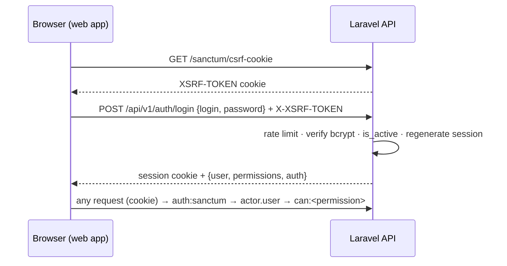
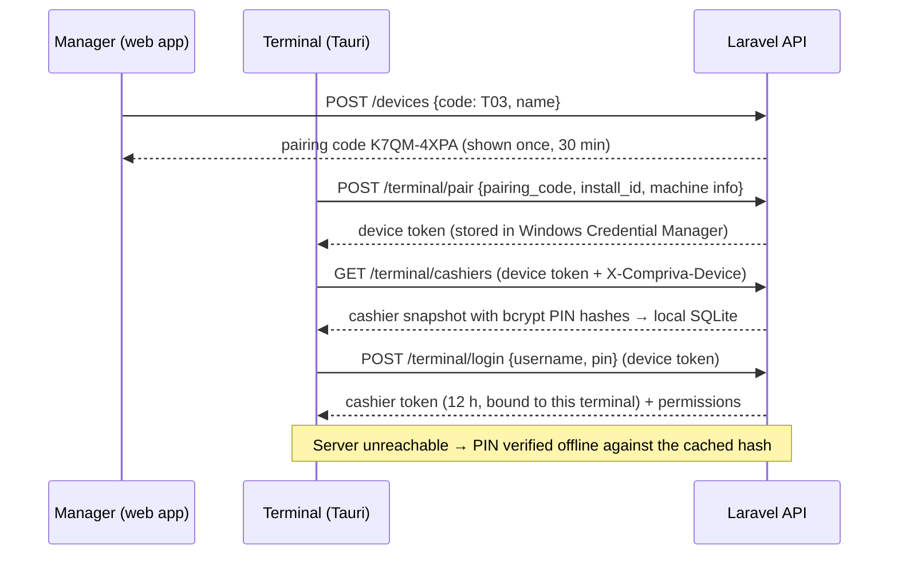

# Authentication and authorization

Laravel Sanctum provides all authentication. Every permission is checked on the server; the
frontend only uses permissions to decide what to show.

## 1. Actors and credentials

| Actor | Proves identity with | Credential storage | Lifetime |
| ----- | -------------------- | ------------------ | -------- |
| **Web user** (back office) | Username or email + password → Sanctum **session cookie** | HttpOnly session cookie + CSRF cookie | `SESSION_LIFETIME` (120 min idle) |
| **Desktop app user** (checkout PC) | The **same username/email + password** as the web app → `POST /auth/token` → Sanctum token | Desktop app memory only | 12 hours (`expires_at`); signs in again after an app restart |
| *Terminal (checkout PC), prepared, not used by the UI yet* | One-time **pairing code** → **device token** (ability `device`) | Windows Credential Manager (`com.compriva.pos` / `device_token`) | Until the terminal is revoked or re-paired |
| *Cashier at a terminal, online (prepared)* | Username + 6-digit **PIN**, sent with the device token → **cashier token** (ability `terminal`, bound to the device) | Terminal memory only | 12 hours (`expires_at`); one per cashier per terminal |
| *Cashier at a terminal, offline (prepared)* | Username + PIN checked against the cached **bcrypt PIN hash** | Session exists only in the UI; nothing is sent to the server | Until sign-out or app restart |

Stored secrets: passwords and PINs are bcrypt hashes (cost 12, Laravel `hashed` casts). Pairing
codes are stored as SHA-256. Sanctum stores only SHA-256 hashes of its tokens. No plaintext secret
is ever stored or logged.

## 2. Flows

### Web sign-in

> **Current behaviour (since Phase 4):** the desktop app signs in exactly like the web app, with
> username or email + password, and receives a 12-hour token from `POST /api/v1/auth/token`
> (the desktop origin cannot use the web session cookie). There is no pairing step. The pairing,
> device-token, PIN and offline sign-in pieces below are implemented and tested on the backend and
> desktop side, but the UI does not use them. They remain available for the offline/sync phase,
> when terminals need their own identity.
>
> In development the desktop app runs its UI on `http://localhost:1420`. It must never be listed in
> `SANCTUM_STATEFUL_DOMAINS`, otherwise Sanctum treats it as a cookie session and demands CSRF tokens.

### Terminal pairing and cashier sign-in (prepared)

## 3. Endpoints

All under `/api/v1`. "Actor": who may call it.

| Endpoint | Actor | Permission | Rate limit |
| -------- | ----- | ---------- | ---------- |
| `POST /auth/login` | public (web app origin) | — | `login` |
| `POST /auth/token` (desktop app: same credentials, returns a token) | public | — | `login` |
| `GET /auth/me` | user | — | `api` |
| `POST /auth/logout` | user | — | `api` |
| `PATCH /auth/profile` (name, email) | user | — | `api` |
| `PUT /auth/password` (current password required) | user | — | `api` |
| `PUT /auth/pin` (current password required) | user | — | `api` |
| `GET /auth/tokens`, `DELETE /auth/tokens/{id}` (own only) | user | — | `api` |
| `GET/POST /users`, `GET/PATCH /users/{id}` | user | `users.manage` | `api` |
| `PUT /users/{id}/roles` | user | `users.manage` | `api` |
| `POST /users/{id}/suspend`, `POST /users/{id}/activate` | user | `users.manage` | `api` |
| `PUT /users/{id}/credentials` (password and/or PIN reset) | user | `users.manage` | `api` |
| `DELETE /users/{id}/access` (sign out everywhere) | user | `users.manage` | `api` |
| `GET /permissions` | user | `roles.manage` | `api` |
| `GET/POST /roles`, `GET/PATCH/DELETE /roles/{id}`, `PUT /roles/{id}/permissions` | user | `roles.manage` | `api` |
| `GET/POST /devices`, `GET/PATCH /devices/{id}` | user | `devices.manage` | `api` |
| `POST /devices/{id}/pairing-code`, `POST /devices/{id}/revoke` | user | `devices.manage` | `api` |
| `POST /terminal/pair` | public | — (pairing code) | `pairing` |
| `GET /terminal/device` | device | — | `api` |
| `POST /terminal/login` | device | — (user needs `pos.access`) | `terminal-login` |
| `GET /terminal/cashiers` | device | — | `api` |
| `GET /dashboard/stock-alerts` | user | `dashboard.view` or `inventory.view` (checked in the controller) | `api` |

**Actor middleware**

- `actor.user`: the authenticated model is a `User` with `is_active = true`. For cashier tokens,
  the bound terminal must be active and `X-Compriva-Device` must match it. Device tokens are refused.
- `actor.device`: the authenticated model is a `Device` with ability `device` and status `active`,
  and `X-Compriva-Device` equals its install ID. User tokens are refused.

Both checks run on **every request**, so suspending a user or revoking a terminal takes effect immediately.

## 4. Offline sign-in at terminals

Checkout must keep working without internet, so a terminal can sign in a cashier without the server:

1. With the device token, the terminal downloads `GET /terminal/cashiers`: active users with
   `pos.access` and a PIN, their **bcrypt PIN hash**, roles and permissions, and a `valid_until`
   (now + `COMPRIVA_SYNC_MAX_OFFLINE_HOURS`, default 72 h). It is stored in SQLite tables `cashiers`
   and `local_meta`. The download repeats on every startup and after every online sign-in.
2. When `POST /terminal/login` fails **because the server is unreachable** (`NETWORK_ERROR` or
   `TIMEOUT`, never a rejected PIN), the UI falls back to `offlineSignIn()`
   (`frontend/src/modules/auth/offline.ts`). The PIN is verified by the native `verify_pin`
   command (`src-tauri/src/offline_auth.rs`, bcrypt).

Protections:

| Threat | Mitigation |
| ------ | ---------- |
| Guessing PINs at the terminal | 5 wrong PINs lock the username for 5 min, doubling per lockout up to 1 h (`auth_lockouts` table). Online sign-in is rate-limited on the server |
| Distinguishing valid usernames | One message for every failure; a bcrypt check runs even for unknown usernames |
| Suspended or removed users signing in offline | They disappear at the next snapshot refresh; the snapshot expires after `valid_until` and is then never used |
| Stolen terminal disk with the SQLite file | Only bcrypt PIN hashes (cost 12), no passwords. **Limitation:** a 6-digit PIN has 10⁶ combinations, so an attacker with the file can brute-force one hash offline in hours to days on GPU hardware. Mitigations: PIN policy (no repeated or sequential PINs), BitLocker on terminal disks (recommended), revoke the terminal (stops the device token) and reset PINs if a terminal is stolen |
| Stolen device token | Stored in Windows Credential Manager (per Windows user). Usable only together with the matching install ID, and revoked with the terminal |
| Offline session misuse | Offline sessions grant no server access: there is no token, and everything done offline is synced later under the device token and attributed to the cashier |

PIN policy (`App\Support\Validation\PinRule`): exactly 6 digits, not all the same digit, not an
ascending or descending run.

## 5. Authorization model

- **Permissions** are defined in code (`App\Domain\Identity\Permissions`, 34 entries) and synced to
  the database by `RolesAndPermissionsSeeder`. Every permission is registered as a Laravel **Gate**.
  Routes use `can:<permission>`, and only active users pass.
- **Roles** group permissions. Seeded system roles: Owner (all), Manager, Cashier, Inventory clerk.
  Owners can create custom roles.
- **Escalation rules** (`App\Domain\Identity\Services\AccessControl`):
  - Nobody can grant a role or permission they do not hold themselves.
  - Nobody can manage a user who has more access than they do.
  - The last active owner cannot be suspended or lose the owner role.
  - Nobody can suspend their own account.
  - The owner role always has every permission; system roles cannot be deleted.
- **Frontend** (`src/modules/auth/permissions.ts`, `components/layout/navigation.ts`): menus and
  controls are filtered by the session's permissions. This is presentation only. The e2e test
  "the API refuses what the UI hides" calls an admin endpoint as a cashier and gets `403`.

## 6. Account lifecycle

| Action | Effect |
| ------ | ------ |
| Suspend | `is_active = false`; all API tokens and web sessions deleted; rejected on every request; dropped from terminal snapshots |
| Activate | `is_active = true`; the user signs in again |
| Admin password reset | New password; all tokens and sessions deleted |
| Own password change | New password; all *other* tokens and sessions deleted; the current one is kept |
| PIN set or reset | New bcrypt hash; terminals pick it up at the next snapshot refresh |
| Revoke access | All tokens and sessions deleted |
| Revoke terminal | Status `revoked`; its device token and every cashier token issued on it deleted; it cannot be paired again (register a new terminal) |

Expired tokens are pruned daily (`sanctum:prune-expired --hours=24`). This needs the Laravel
scheduler (`php artisan schedule:work` or a cron entry) in production.

## 7. Audit events

Written to `audit_logs` with the acting user or terminal, IP, user agent and request ID. Values
named `password`, `pin`, `token`, `pairing_code` and similar are always replaced by `[redacted]`.

`auth.login`, `auth.login_failed`, `auth.login_blocked`, `auth.logout`, `auth.terminal_login`,
`auth.terminal_login_failed`, `auth.profile_updated`, `auth.password_changed`, `auth.pin_changed`,
`auth.token_revoked`, `user.created`, `user.updated`, `user.roles_changed`, `user.suspended`,
`user.activated`, `user.password_reset`, `user.pin_reset`, `user.access_revoked`, `role.created`,
`role.updated`, `role.permissions_changed`, `role.deleted`, `device.registered`,
`device.pairing_code_issued`, `device.paired`, `device.pairing_failed`, `device.revoked`.

## 8. Frontend

| Piece | File |
| ----- | ---- |
| Auth state (Zustand): bootstrap, web login, cashier login with offline fallback, pairing, logout; signs out on any `401 UNAUTHENTICATED` | `src/modules/auth/store.ts` |
| Login screen: web form, terminal pairing, cashier PIN sign-in | `src/modules/auth/components/login-screen.tsx` and forms |
| Protected routes: everything under `app/(app)` goes through `AuthGuard` → `/login?next=…` (same-app paths only) | `src/modules/auth/components/auth-guard.tsx` |
| Role-based navigation | `src/components/layout/navigation.ts`, `app-shell.tsx` |
| Profile: details, roles, permissions, password and PIN change (disabled offline) | `src/modules/auth/components/profile-page.tsx` |

Production note: web app and API must share a parent domain (`app.example.ph` / `api.example.ph`)
with `SESSION_DOMAIN=.example.ph`, `SESSION_SECURE_COOKIE=true` and `SANCTUM_STATEFUL_DOMAINS=app.example.ph`
([environment.md](environment.md)).
