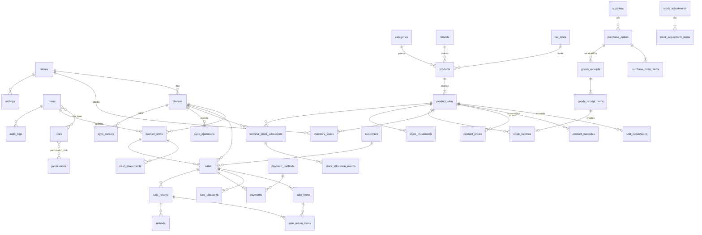
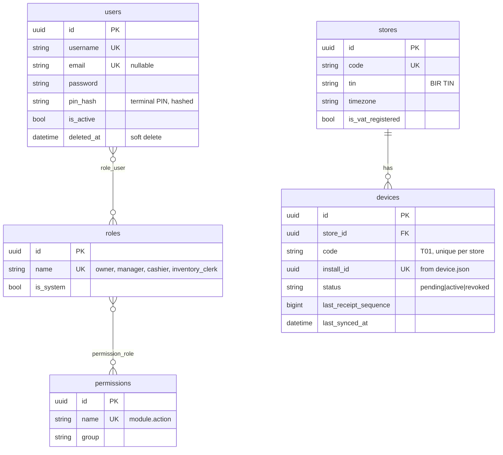
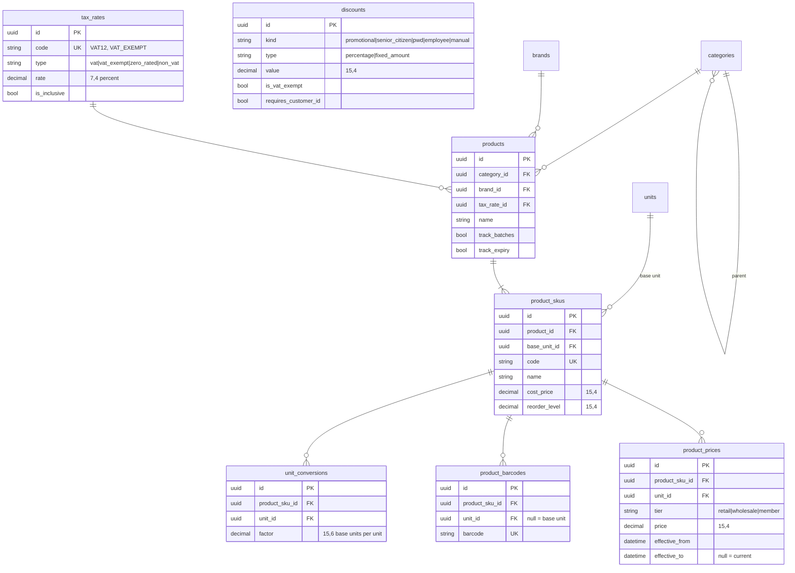
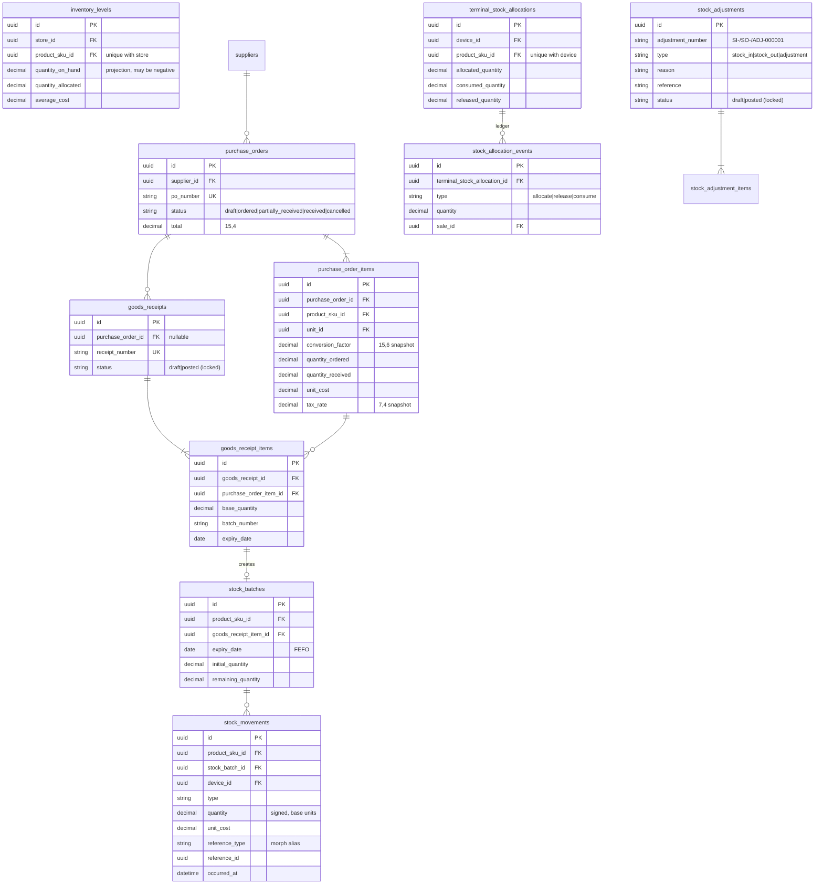
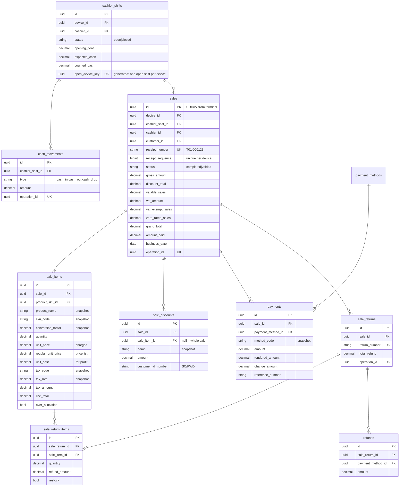
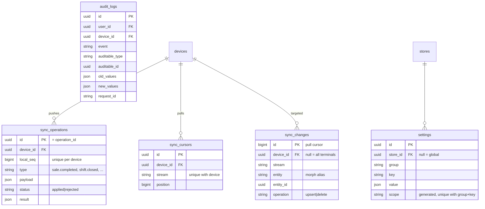

# Database design

Central database for Compriva: **MySQL 8.4 LTS** in production, verified on XAMPP MariaDB 10.4
in development. 19 migrations create **54 tables**: 45 application tables plus 9 framework
tables (Laravel sessions, cache, jobs, migrations, Sanctum tokens). Integrity is enforced by
102 foreign keys, 40 CHECK constraints and 35 triggers. MariaDB also adds a `json_valid` check to
each of its 5 JSON columns.

Source: `backend/database/migrations`, models in `backend/app/Models`, enums in
`backend/app/Domain/*/Enums`, tests in `backend/tests/Feature/Database`.

## 1. Design decisions

| # | Decision | Why |
| - | -------- | --- |
| D1 | **UUIDv7 primary keys** (`CHAR(36)`) on every application table, generated by `HasUuids` or by the terminal | Terminals create sales, shifts, payments and customers offline, with no ID clashes. v7 is time-ordered, so inserts stay index-friendly, unlike random v4 keys |
| D2 | Exceptions: Laravel framework tables, `role_user` / `permission_role` (composite keys), `sync_changes` (auto-increment) | The pull cursor must be strictly increasing and gap-tolerant; UUIDs from different app servers are not strictly ordered |
| D3 | **`DECIMAL(15,4)`** for money and quantities, **`DECIMAL(15,6)`** for unit conversion factors, **`DECIMAL(7,4)`** for tax rates (percent: `12.0000`) | Exact arithmetic. 4 places hold per-unit costs and weighed quantities (`1.2345` kg) without rounding loss; 6 places hold factors like 1 g = 0.001000 kg |
| D4 | Decimals are **strings** in PHP (`decimal:4` casts, bcmath), the API and TypeScript | Floats would silently corrupt totals |
| D5 | **`DATETIME`** columns (`datetimes()`), values in **UTC**; `business_date` (`DATE`) in Asia/Manila on sales and returns | `TIMESTAMP` overflows in 2038 and converts by session timezone. `business_date` makes daily reports and Z-readings a simple indexed equality |
| D6 | **Snapshots on financial lines**: sale items store product name, SKU code, barcode, unit name, conversion factor, regular and charged price, unit cost, tax code/type/rate and amounts. Sale discounts and payments store their definition and method code. Sales store a customer snapshot | Receipts and reports must reproduce the past exactly, even after products, prices, taxes or customers change |
| D7 | **Effective-dated prices** (`product_prices.effective_from/effective_to`) instead of a price column | Full price history; price changes can be scheduled; terminals receive future prices before they apply |
| D8 | **Product → SKU → unit conversions / barcodes / prices** | A product ("Coca-Cola") has sellable SKUs ("1.5L", "330ml"). Stock is per SKU in its base unit. Any number of selling or purchase units (case = 12) and barcodes per unit (the case barcode scans as 1 case) |
| D9 | **Append-only stock ledger** (`stock_movements`, signed quantity in base units) is the source of truth; `inventory_levels` and `stock_batches.remaining_quantity` are projections updated in the same transaction | Auditable stock history; projections can always be rebuilt from the ledger |
| D10 | **Terminal stock allocations** with an append-only event ledger | Offline terminals cannot sell the same units. `consumed` may exceed `allocated` (store setting `pos.allow_over_allocation`; lines flagged `over_allocation`) |
| D11 | **Restrictive deletes**: 96 of 102 foreign keys are `RESTRICT`. Only 6 cascade: pivot rows, unit conversions and barcodes of a SKU | Nothing referenced by a financial record can disappear. Master data is **soft-deleted** (`deleted_at`) instead |
| D12 | **Completed sales are preserved**: never deleted; amounts frozen; the only change is `completed → voided`, which is final. Returns are separate records linked to the sale | Required for audit, BIR compliance and offline reconciliation |
| D13 | **Posted documents are locked** (goods receipts, stock adjustments) | After posting, stock has moved. Corrections are new documents |
| D14 | Only **completed** sales exist in the cloud database. Carts live and die on the terminal | No half-finished financial rows; sync uploads facts |
| D15 | **Idempotency keys in the schema**: `operation_id` is unique on sales, shifts, cash movements and returns; `sync_operations.id` = operation ID; `(device_id, local_seq)` is unique | A retried sync push can never create a second sale |
| D16 | **Per-terminal receipt numbering**: `(device_id, receipt_sequence)` unique; `receipt_number` globally unique (`T01-000123`) | Sequential per machine, no cross-terminal collisions offline |
| D17 | **Status columns are strings + PHP enums + CHECK constraints**, not MySQL `ENUM` | Adding a status is a code change plus one constraint, not an `ALTER` rewriting the column |
| D18 | **Morph map aliases** (`sale`, `goods_receipt`, `device`, …) in polymorphic columns (`App\Support\Database\MorphMap`) | Class names never reach the database. Models can be renamed safely |
| D19 | `store_id` on every operational table, although there is one store | Multi-store later without schema changes |
| D20 | Roles and permissions in own tables; permission catalog defined in code (`App\Domain\Identity\Permissions`) and synced by the seeder | UUID keys throughout, no package lock-in, permissions referenced safely in code |
| D21 | Philippine tax built into the schema: `vatable_sales`, `vat_amount`, `vat_exempt_sales`, `zero_rated_sales` on sales; tax type per line; SC/PWD discount kinds with customer ID number | Receipt and BIR reporting breakdowns come straight from stored values |

## 2. Integrity enforcement

Rules are enforced in **two layers**. Eloquent fails fast with `ImmutableRecordException`. The
database is the final guarantee, even for raw SQL, other tools or bugs.

| Rule | Database | Eloquent |
| ---- | -------- | -------- |
| Stock movements, sale items, sale discounts, payments, cash movements, returns, return items, refunds, allocation events, audit logs are append-only | `*_prevent_update`, `*_prevent_delete` triggers | `AppendOnly` trait |
| Sales never deleted; financial columns frozen; void is final | `sales_prevent_delete`, `sales_freeze_financials`, `sales_void_is_final` | `Sale::booted()` (same column list `Sale::FROZEN_COLUMNS`) |
| Voided ⇔ `voided_at` set; fully paid | CHECK `sales_status_check`, `sales_payment_check` | |
| Shifts never deleted; closed shifts frozen; one open shift per terminal | triggers + unique stored column `open_device_key` | `CashierShift::booted()` |
| Posted goods receipts and stock adjustments locked (header and lines, including new lines) | `Integrity::lockWhenPosted()` triggers | `LockedWhenPosted` trait (header) |
| Non-negative money; positive quantities; batch remaining ≤ received; tax 0–100%; factor > 0; tender − change = amount | CHECK constraints (`*_check`) | |
| Referenced rows cannot be deleted | `RESTRICT` foreign keys | soft deletes on master data |
| Uniqueness: barcode, SKU code, receipt number, `(device, receipt_sequence)`, operation IDs, `(device, sku)` allocation, `(scope, group, key)` setting | unique indexes | |

**Not enforced by the database** (multi-row arithmetic; enforced by domain Actions inside one
transaction, and checked by reconciliation reports):

- `sales.gross_amount` = Σ `sale_items.gross_amount`; `amount_paid` = Σ `payments.amount`.
- Returned quantity per sale item ≤ sold quantity.
- `inventory_levels.quantity_on_hand` = Σ `stock_movements.quantity` per store and SKU.
- Allocation totals = Σ allocation events by type; `inventory_levels.quantity_allocated` = Σ unconsumed allocations.
- `purchase_order_items.quantity_received` = Σ posted goods receipt item quantities.

Triggers raise `SQLSTATE 45000` with a readable message. CHECK violations surface as
`SQLSTATE 23000` on MariaDB and `HY000` (error 3819) on MySQL 8. Both are covered by
`DatabaseTestCase::assertCheckFails()`.

## 3. Entity-relationship diagrams

### 3.1 Overview

### 3.2 Identity, stores and devices

### 3.3 Catalog, pricing and tax

### 3.4 Purchasing and inventory

### 3.5 Sales, payments, shifts and returns

### 3.6 Synchronization, settings and audit

## 4. Table catalog

| Domain | Tables | Notes |
| ------ | ------ | ----- |
| 1. Users, roles, permissions | `users`, `roles`, `permissions`, `role_user`, `permission_role` | Users soft-deleted; PIN hash for terminal sign-in |
| 2. Stores, devices | `stores`, `devices` | Device tokens live in `personal_access_tokens` (tokenable `device`) |
| 3. Categories, brands, units | `categories` (tree), `brands`, `units` | |
| 4. Products, SKUs, barcodes | `products`, `product_skus`, `product_barcodes`, `product_images` | Images cascade with their product; files on the private `local` disk |
| 5. Conversions, pricing | `unit_conversions`, `product_prices` | |
| 6. Tax, discounts | `tax_rates`, `discounts` | Seeded: VAT12, VAT_EXEMPT, ZERO_RATED, NON_VAT; SC20, PWD20 |
| 7. Suppliers, purchasing | `suppliers`, `purchase_orders`, `purchase_order_items`, `goods_receipts`, `goods_receipt_items` | |
| 8. Inventory, batches | `inventory_levels`, `stock_batches` | |
| 9. Terminal allocations | `terminal_stock_allocations`, `stock_allocation_events` | |
| 10. Movements, adjustments | `stock_movements`, `stock_adjustments`, `stock_adjustment_items` | `stock_adjustments` holds every manual stock document (stock in, stock out, count); lines keep the entered unit, quantity and factor. Only `StockLedger` changes levels and batches ([products-inventory.md](products-inventory.md)) |
| 11. Customers | `customers` | Terminals may create customers (`created_by_device_id`) |
| 12. Sales | `sales`, `sale_items`, `sale_discounts` | |
| 13. Payments | `payment_methods`, `payments` | Seeded: cash, gcash, maya. GCash and Maya are paid by QR code (`qr_image_path`, `account_name`, `account_number`, Phase 6); card and bank transfer are switched off |
| 14. Shifts, cash | `cashier_shifts`, `cash_movements` | |
| 15. Returns, refunds | `sale_returns`, `sale_return_items`, `refunds` | |
| 16. Sync | `sync_operations`, `sync_changes`, `sync_cursors` | |
| 17. Settings, audit | `settings`, `audit_logs` | |

## 5. Seed data

| Seeder | Runs in | Creates |
| ------ | ------- | ------- |
| `RolesAndPermissionsSeeder` | all | 34 permissions, 4 system roles (owner, manager, cashier, inventory_clerk) |
| `ReferenceDataSeeder` | all | 12 units (incl. bottle, tray), 4 tax treatments, 5 payment methods, SC/PWD discounts, 12 default settings (never overwrites edited values) |
| `StoreAndOwnerSeeder` | all | The store and the first owner. Outside `local`/`testing` it requires `COMPRIVA_OWNER_PASSWORD` |
| `DemoDataSeeder` | `local` only | 4 staff (password `password`; cashier PINs 482916 / 739215 (6-digit policy)), terminals T01/T02, 12 grocery SKUs with case units, barcodes (GS1 prefix 2) and prices, 3 suppliers, 3 customers, opening stock (posted adjustment, ledger, batches for perishables), 10% allocations per terminal |

All reference seeders are idempotent: `php artisan db:seed` can run on every deploy.

## 6. MySQL 8.4 / MariaDB compatibility and operations

- Only portable SQL is used: InnoDB, `utf8mb4_unicode_ci`, `CHAR(36)` UUIDs, `JSON`, CHECK
  constraints, STORED generated columns, `BEFORE` triggers with `SIGNAL`. No partial indexes
  (MySQL has none); a unique index on a generated column replaces them (`open_device_key`, `settings.scope`).
- MySQL restriction honoured: CHECK constraints and generated columns never reference a column used by a
  `CASCADE` / `SET NULL` foreign key.
- **Deployment:** creating triggers on MySQL with binary logging needs the `TRIGGER` privilege
  and, on managed MySQL (RDS, Cloud SQL, Azure), `log_bin_trust_function_creators = 1`.
  Run migrations as a user that has it.
- `php artisan db:show` fails on XAMPP MariaDB (performance_schema disabled); not an application issue.
- Migrations are fully reversible (`migrate:rollback` of all 19 verified). The changes to the
  starter `users` and `personal_access_tokens` migrations were made before any deployment.

## 7. Local terminal database (SQLite)

Mirrors the conventions: UUIDv7 text keys, money and quantities as **TEXT decimal strings**
(SQLite has no exact decimal type; REAL would introduce float error), timestamps as ISO-8601 UTC
text. Tables are added in the Sync phase ([offline-sync.md §3](offline-sync.md#3-local-database-terminal)).
